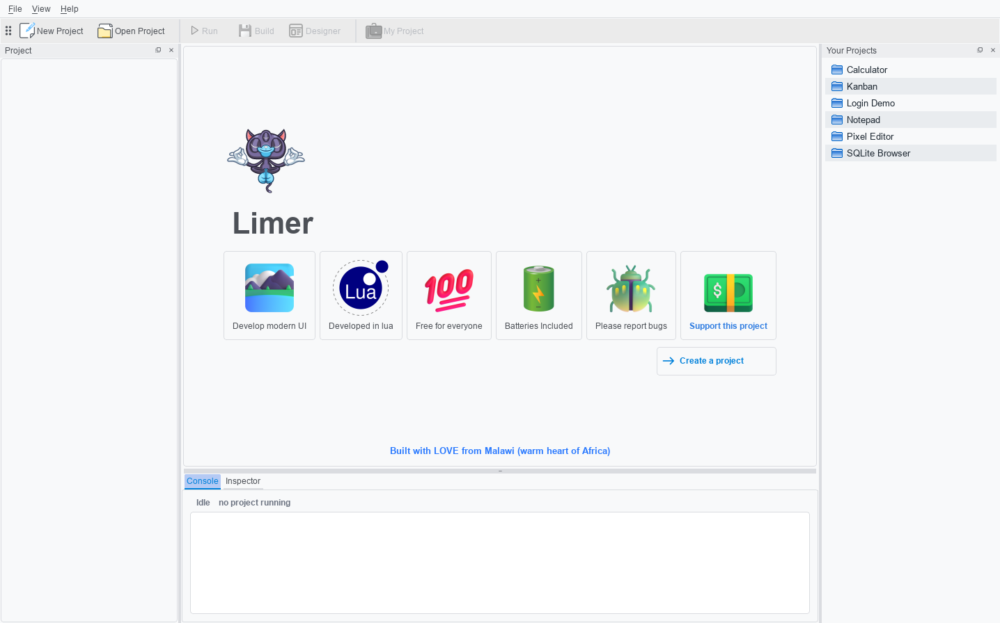
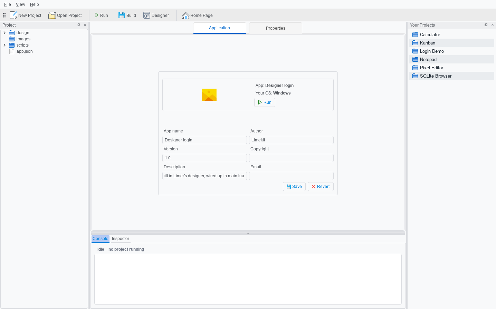
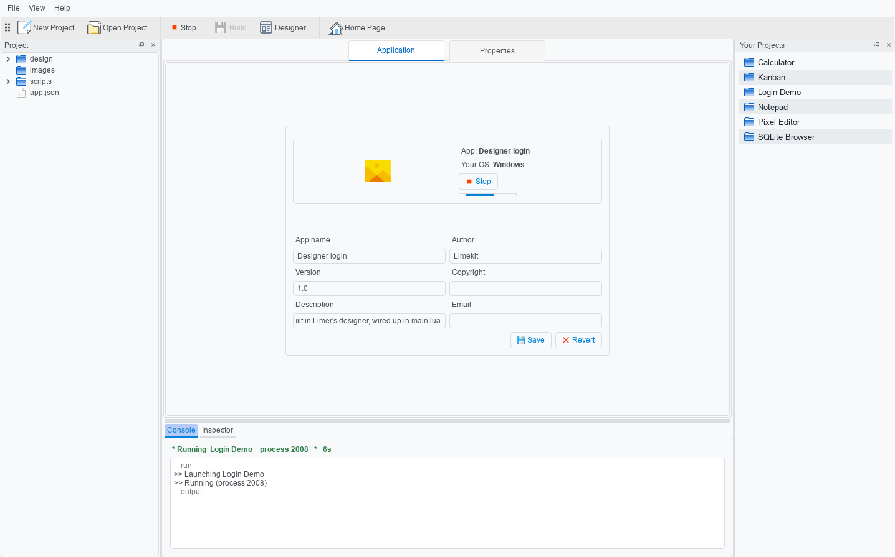
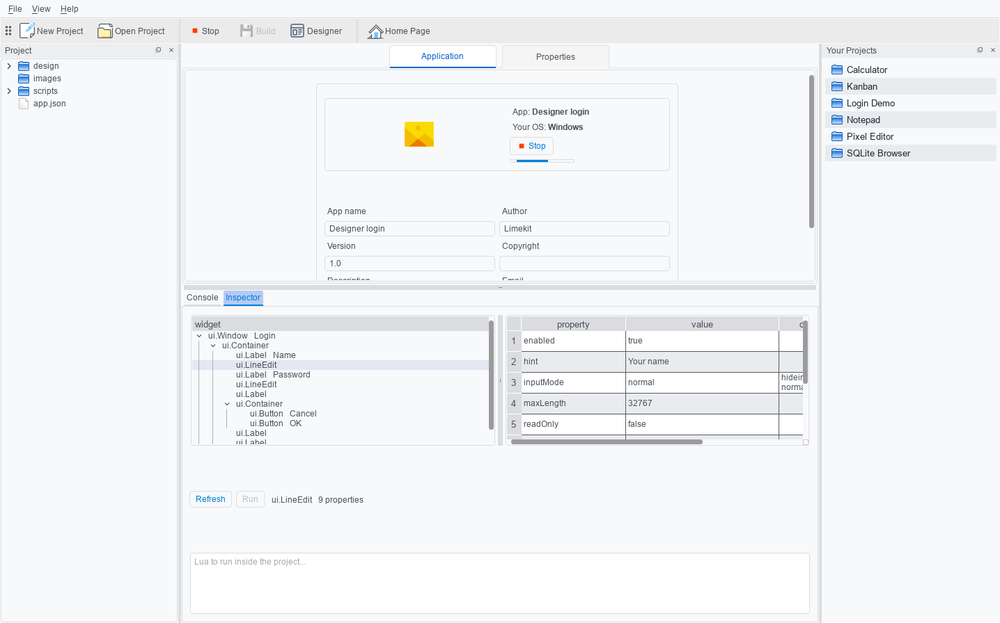
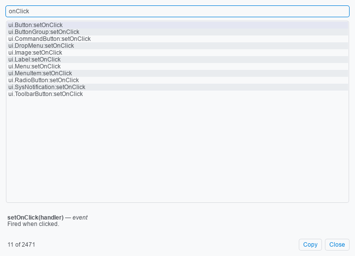
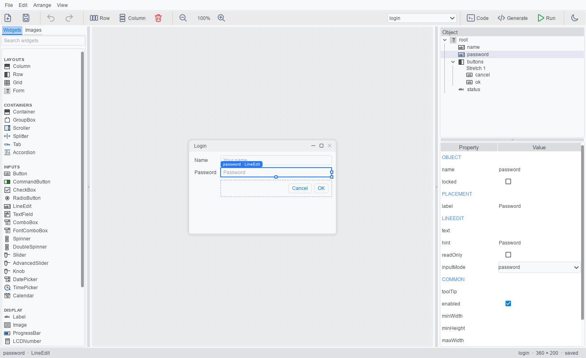
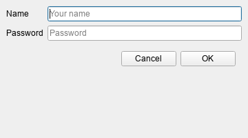
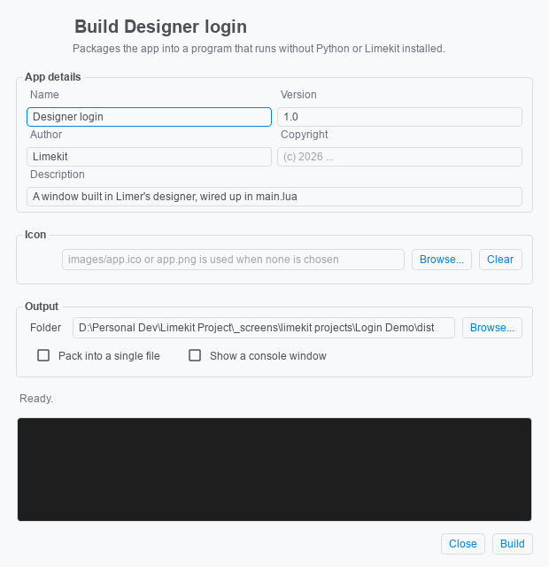

=================
Using Limer
=================

.. contents:: Content
    :depth: 1
    :local:
    :backlinks: top

**Limer** is the app you make Limekit apps with. It creates projects, runs
them, shows you inside them while they run, lets you design windows by
dragging widgets, and builds the finished app into a program you can hand to
anyone.

Limer is one download with everything inside it -- Python, Qt and the Limekit
framework. Get ``Limer-2.0-windows.zip`` from the
`Limer releases <https://github.com/mitosisX/Limer-Limekit/releases>`_, unzip
it anywhere and run ``Limer.exe``. There is nothing else to install.

.. note::

   The download is not code-signed yet, so the first time you run it Windows
   may say *"Windows protected your PC"*. Click **More info**, then
   **Run anyway**.

The home page
===============

   Limer as it opens.

- **The toolbar** -- *New Project* and *Open Project* work straight away. *Run*,
  *Build* and *Designer* light up once a project is open.
- **Your Projects** (right) -- every project in your Limekit projects folder,
  ``Documents\limekit projects``. Double-click one to open it.
- **Console and Inspector** (bottom) -- what your app prints, and a look inside
  it while it runs.

Creating a project
====================

.. figure:: images/limer/new-project.png
   :alt: The Create New Project dialog
   :width: 440px

   **New Project** asks for a name, a version and, optionally, an icon.

Click **New Project** (or *Create a project* on the home page), name the
project and click **Create Project**. Limer makes the folder, writes a
starting ``scripts/main.lua`` that opens a window, and opens the project.

Every project has the same shape:

.. code-block:: text

   My App/
   ├── app.json          name, version, author -- and "api": "2.0"
   ├── scripts/main.lua  where your app starts
   ├── images/           pictures your app uses
   └── misc/             anything else it needs at run time

With a project open
=====================

   A project open: its files on the left, its details in the centre.

- **Project** (left) -- the project's files. Double-click a file and it opens
  in whatever your computer uses for that kind of file, so ``.lua`` files open
  in your own editor.
- **Application** and **Properties** (centre) -- the project's name, version,
  author and the rest of ``app.json``, editable here. *Save* writes them back.
- **Home Page** (toolbar) switches back to the home page; on the home page the
  same button reads *My Project* and switches back.

You write the Lua in your own editor. Limer puts a ``.luarc.json`` in the
project, so VS Code -- with the *Lua* extension by sumneko installed --
completes the Limekit API and underlines typos straight away. Press **Run** -- in the toolbar, in the
Application tab, or with **Ctrl+R** -- to start the app.

Running your app
==================

   While the app runs, the console says so, and for how long.

The **Console** shows everything your app prints, and any error -- with the
file and line it happened on. It also tells you how the run ended: finished on
its own, stopped from Limer, or crashed. **Stop** (or **Ctrl+X**) closes the
app.

The Inspector
===============

   The Inspector, looking into a running login window: the password field is
   selected, and its live properties are on the right.

While your app runs, open the **Inspector** tab. The left side is your app's
widget tree as it is *right now*. Pick a widget and its properties appear on
the right -- read them, or change one and watch the app change with it, without
restarting. The box at the bottom runs a line of Lua inside your app.

The Inspector only works on an app Limer started. An app you ship never has
it switched on.

Finding your way around the API
=================================

   **Ctrl+K**, searching for ``onClick``.

Press **Ctrl+K** anywhere in Limer to search the whole Limekit API -- every
class, method, property and event. Pick one to see what it takes and what it
does, and press **Enter** (or *Copy*) to copy the call, ready to paste into
your code.

The Designer
==============

   The Designer, with a login form being designed. The password field is
   selected: the outline (top right) shows where it sits, and Properties
   (bottom right) everything about it.

Open a project, then click **Designer** in the toolbar (or press
**Ctrl+Shift+D**). The Designer opens in a window of its own.

- **Widgets** (left) -- drag any of them onto the canvas. **Images** beside it
  manages your project's pictures.
- **The canvas** (centre) -- the window you are designing, drawn as it will
  look. The widgets on it are real Limekit widgets, not pictures of them; a
  click selects one rather than pressing it.
- **Object** (top right) -- the design as a tree.
- **Properties** (bottom right) -- everything about what is selected: its
  name, where it sits, and every property it has.

**Layouts, not coordinates.** A widget dropped on the canvas lands *in* a row,
a column, a grid or a form -- the orange marker shows where -- rather than at
an x and a y. That is what lets a designed window resize properly. Drag placed
widgets to move them, drag a handle to set a minimum size, and double-click to
edit text. The **Arrange** menu wraps widgets in rows, columns, grids, forms
and group boxes, and right-click gives the same commands for the widget under
the mouse. **Ctrl+Z** undoes.

Seeing and using the code
---------------------------

.. figure:: images/limer/designer-code.png
   :alt: The Designer with Code open: the generated Lua under the canvas
   :width: 100%

   **Code** shows the Lua the design becomes, kept up to date as you work.

**Generate** writes that code to ``scripts/designed/<name>.lua``. Your
``main.lua`` uses it like this:

.. code-block:: lua

   local login = require("designed.login").new()

   login.ok:setOnClick(function()
       print("hello, " .. login.name:getText())
   end)

   login.window:show()

Every widget is there by the name you gave it, so your code wires up what
happens. Each ``new()`` builds a fresh window. The design is kept in
``design/<name>.design.lua``; the generated module is never read back, so
change the design and generate again rather than editing the generated file.

**Run** in the Designer (**Ctrl+R** there) shows the design as a real window,
without touching your ``main.lua``:

   The same login form, running.

Building your app
===================

   **Build** turns the project into a program anyone can run.

Click **Build** in the toolbar. Check the name, version and the other details
-- they are filled in from your project -- choose an icon if you like, and
click **Build**. About a minute later you have your app:

- **Pack into a single file** -- one ``.exe``. Left unticked, you get a folder
  holding the ``.exe`` and its files, which starts a little faster.
- **Show a console window** -- a terminal beside the app showing ``print()``
  output and errors. Useful while testing; leave it off for the version you
  give away.

The people you give your app to install nothing -- no Python, no Limekit.
Like Limer itself, an app you build is not code-signed, so Windows may show
the same *"Windows protected your PC"* message the first time it runs.

Coming from Limekit 1.x
=========================

Limer 2.0 runs Limekit 2.0 projects. Open a 1.x project and Limer tells you
so instead of running it. The
`Limekit 1.0 release <https://github.com/mitosisX/Limer-Limekit/releases/tag/limekit1.0>`_
still runs 1.x projects as they are; to move one across, see
:doc:`Migrating from 1.x <migrating>`.

Support
=========

Limer and Limekit are free, and made by one person. If they are useful to
you, you can `buy me a coffee <https://buymeacoffee.com/omegamsiska>`_.
